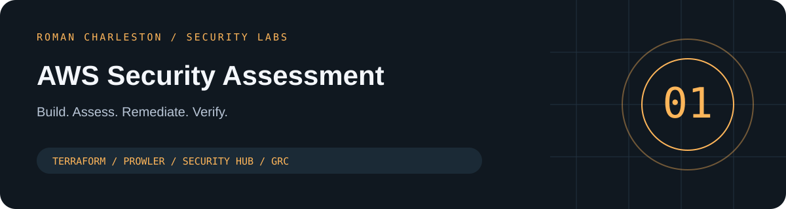
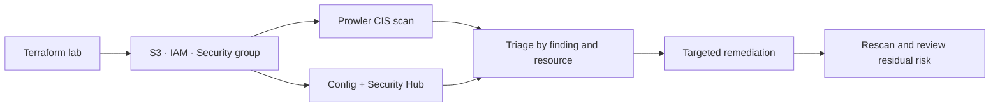

# AWS Security Assessment · Stride capstone

**A completed cloud-security lab with original Terraform, measured scan results, and a documented remediation review.**

[Portfolio case study](https://grcengineer.io/projects/aws-security-assessment/) · [Original Medium walkthrough](https://medium.com/@romancharleston/i-built-a-vulnerable-aws-environment-for-my-capstone-class-f30b8e108fa6) · [Findings register](docs/findings.md) · [Evidence notes](evidence/README.md)

## The 60-second tour

Stride is a fictional SaaS company used in my cybersecurity capstone. I built an intentionally misconfigured AWS environment, assessed it with Prowler and Security Hub, made targeted changes, and compared the results. This repository packages that completed lab for review; it does not represent a production client engagement or a SOC 2 certification.

| Start here | What you can inspect |
|---|---|
| [Terraform fixture](lab/stride-vulnerable.tf.example) | Original resource definitions and the five assessment themes |
| [Findings and residual risk](docs/findings.md) | What changed, what the evidence supports, and what still needs work |
| [Sanitized scan aggregate](evidence/after-check-summary.csv) | Check IDs, statuses, and counts from the original export |
| [Offline result summary](tools/summarize.py) | A reproducible calculation with no cloud connection |

## Measured outcome

| CIS scan result | Before | After |
|---|---:|---:|
| Passing result rows | 71 | 76 |
| Failing result rows | 96 | 91 |
| Pass rate, excluding manual checks | 42.51% | 45.51% |

The after export also contains **3 manual result rows**. These are excluded from the pass-rate denominator. The change is **5 more passing rows / 2.99 percentage points**, not evidence that the account became compliant. Some checks also change because of time windows or delayed evaluation; attribution needs resource-level evidence.

## Assessment flow



## Try the evidence review locally

Requires Python 3.10+; no third-party packages or AWS credentials.

```sh
git clone https://github.com/rcharleston/aws-security-assessment.git
cd aws-security-assessment
python tools/summarize.py
python -m unittest discover -s tests -v
```

The Terraform source is deliberately stored as **`.tf.example`** because it describes insecure historical lab conditions. The quick start only reads sanitized evidence; it creates no cloud resources.

## What this demonstrates

- Infrastructure-as-code review across identity, storage, and network controls.
- Finding triage that separates scoped issues from account-wide noise.
- Evidence handling, reproducible reporting, and explicit residual-risk tracking.
- Technical judgment: default encryption is not the same as an explicit policy; moving an admin policy to a group is not least privilege.

## Repository map

```text
assets/       Visual identity
docs/         Findings, scope, and remediation analysis
evidence/     Sanitized aggregates and provenance
lab/          Historical Terraform fixture
tools/        Offline evidence summary
tests/        Calculation and input-validation checks
```

**Provenance:** the lab and original write-up are by Roman Charleston. Repository documentation and the offline helper were added when packaging the project. No new live AWS assessment is implied. Cloud credentials, Terraform state, private keys, and unredacted raw reports are excluded.
